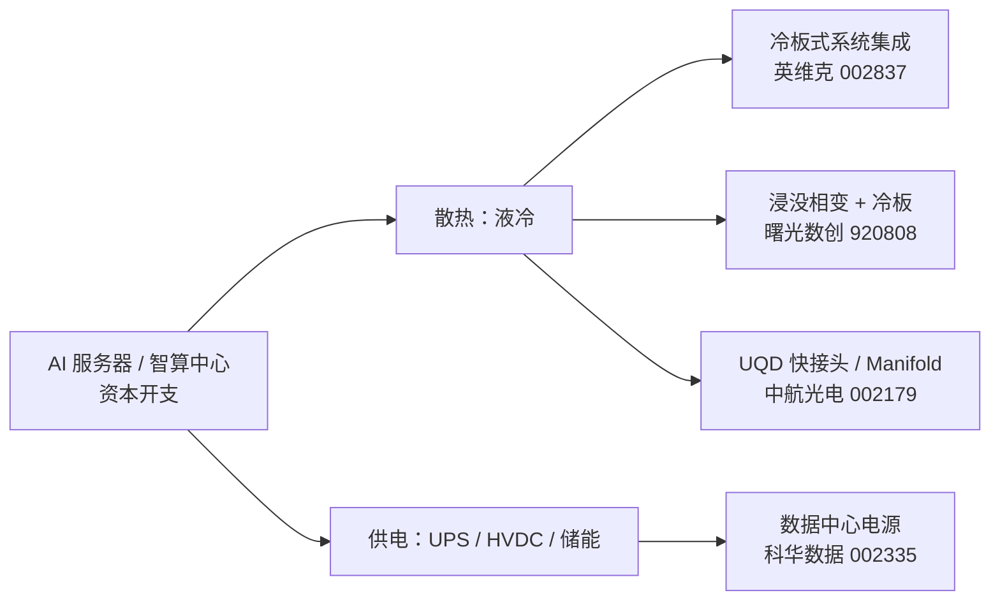
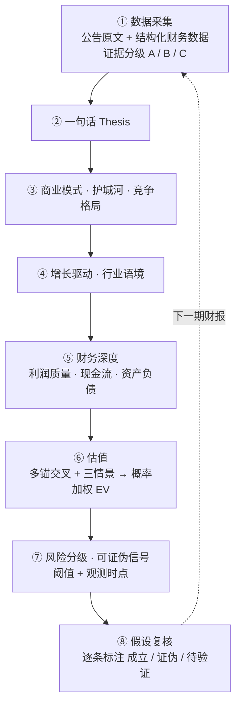

<div align="center">

# A 股个股研究 · AI 算力基础设施
<sub>A-Share Equity Research · AI Data-Center Infrastructure</sub>

四家 A 股液冷与数据中心供电公司的深度研究报告，写给想看一套完整买方式拆解过程的读者</br>
*Four in-depth Chinese equity research reports on A-share liquid-cooling and data-center power companies, with scenario-weighted EV and public assumption reviews.*


[英维克](reports/002837-英维克/README.md) · [中航光电](reports/002179-中航光电/README.md) · [曙光数创](reports/920808-曙光数创/README.md) · [科华数据](reports/002335-科华数据/README.md) · [作者主页](https://charles77.com)

</div>

> AI 算力的资本开支最终要落到机房里：散热（液冷）、流体连接（UQD 快接头）、供电（UPS / HVDC）。这个仓库收录了我在这条链上跟踪的四家 A 股公司的深度报告，每份都用公告原文核实到 2026 年三季报。四份报告的共同结论是：**收入在增长，但利润和现金流没有同步跟上**，市场给的"AI 溢价"需要逐家拆开看。

## 目录

- [核心结论](#核心结论)
- [内容一览](#内容一览)
- [产业链位置](#产业链位置)
- [研究框架](#研究框架)
- [仓库结构](#仓库结构)
- [如何阅读](#如何阅读)
- [说明与免责](#说明与免责)

## 核心结论

1. **增收不增利是四家的共同问题。** 英维克 1-3Q 营收 +22.94%、归母 -7.62%；曙光数创前三季度营收 +16.67%、归母 -1.19 亿；中航光电 Q3 营收 +47.87%，但前三季度经营现金流 -11.04 亿、应收 150.25 亿。收入能不能变成现金，是 2026 年报的共同裁决点。
2. **归母高增不等于主业兑现。** 科华数据 1-3Q 归母 +40.20%，扣非只有 +6.16%，利润增量主要来自出售科云辰航股权；H1 数据中心行业毛利率 23.07%，同比 -6.28pt。
3. **估值倍数要跟着毛利率走。** 曙光数创 H1 冷板毛利率 8.43%、浸没收入 -81.30%，把 PS 倍数改为与毛利率挂钩后，三情景 EV 约 -7.6%。
4. **判断错了就改。** 中航光电此前用 Q1 外推全年盈利，被前三季度归母 19.35 亿（Q3 单季 +172.13%）推翻，三情景重算后 EV 约 +14%。每份报告都有一节「假设复核」，逐条列出原假设现在是成立、证伪还是待验证。

## 内容一览

| 标的 | 代码 | 链条位置 | 一句话结论（2026-10-30） | 建立 / 刷新 | 报告 |
|---|---|---|---|---|---|
| 英维克 | 002837.SZ | 液冷温控 · 系统集成 | Q3 营收 +33.04%、H1 境外 +71.39%，收入在加速；但 H1 机房温控毛利率 23.34% 触发证伪阈值，PE TTM 98.4x，EV ≈ -2.1%，**等待** | 2026-06-23 / 2026-10-30 | [阅读](reports/002837-英维克/README.md) |
| 中航光电 | 002179.SZ | 液冷 UQD 连接器 + 军工电子 | Q3 单季归母 8.16 亿（+172.13%）出现盈利拐点，PE 29.49x 低于近十年 30% 分位；液冷 H1 收入 -16.31%，现金含量不足，EV ≈ +14% | 2026-06-23 / 2026-10-30 | [阅读](reports/002179-中航光电/README.md) |
| 曙光数创 | 920808.BJ | 浸没相变液冷 | 增长引擎切到低毛利冷板，H1 浸没收入 -81.30%、前三季度经营现金流 -4.71 亿、资产负债率 75.47%；"浸没期权"名存实亡，EV ≈ -7.6% | 2026-06-23 / 2026-10-30 | [阅读](reports/920808-曙光数创/README.md) |
| 科华数据 | 002335.SZ | 数据中心供电（UPS / HVDC）+ 储能 | 1-3Q 归母 +40.20% 主要来自股权处置，扣非 +6.16%；PE TTM 30.97x，EV ≈ +10.5%，**中性观察** | 2026-07-08 / 2026-10-30 | [阅读](reports/002335-科华数据/README.md) |

> EV 为作者自建的 Bull / Base / Bear 三情景概率加权期望收益，输入参数在各报告的估值章节里全部列出，可以复算。

## 产业链位置



## 研究框架

每份报告都按同一条链路搭建，每次刷新时从头再走一遍：



1. **证据分级**：[A] 公告与定期报告原值、结构化财务数据；[B] 互动问答与作者自行推算；[C] 媒体资讯与卖方观点的二手转述。用到 [C] 级证据的结论会单独标注，并下调置信度。
2. **估值透明**：三情景的概率、盈利、倍数全部写出来，EV 可以复算；EV 变化时会说明它来自股价还是来自基本面。
3. **可证伪**：关键假设都写成"阈值 + 观测时点 + 数据源"，到期就裁决，不靠事后解释。
4. **假设复核**：每次财报刷新后，逐条检查原假设是否成立，并把被证伪的判断写进结论。

两种报告模板的章节对应如下：

| 环节 | 英维克 / 中航光电 / 曙光数创（12 节深度报告） | 科华数据（Part A–G 深度研究） |
|---|---|---|
| 结论 | Thesis in 1 Sentence | 一句话结论 · 能力圈评估 |
| 业务与竞争 | 1 Business Model · 2 Competitive Advantage | Part A 商业实质 · Part B 竞争格局 |
| 增长与行业 | 3 Revenue Drivers · 6 Industry Context | Part E A 股主题因子 |
| 风险 | 4 Key Risks · 9 Key Metrics to Track | Part F 对手方分析 · 六红线体检 |
| 财务 | 5 财务深度分析 | Part C 财务深度 |
| 估值 | 7 Catalysts & Valuation · 8 Bull / Bear Case | Part D 估值双轨制 · Part G 综合判断 |
| 复核 | 假设复核 · 数据来源台账 | 假设复核 · 数据来源台账 · 反方审查记录 |

## 仓库结构

```text
A-Share-Equity-Research/
├── README.md                     # 本页：总览与研究框架
├── LICENSE                       # CC BY-NC 4.0
└── reports/
    ├── 002837-英维克/README.md     # 液冷温控 · 系统集成
    ├── 002179-中航光电/README.md   # 液冷连接器 + 军工电子
    ├── 920808-曙光数创/README.md   # 浸没相变液冷（北交所）
    └── 002335-科华数据/README.md   # 数据中心供电 + 储能
```

## 如何阅读

- **只看结论**：读上面的表格，再读每份报告开头的 Thesis / 一句话结论。
- **看估值怎么算**：英维克、中航光电、曙光数创看第 7、8 节，科华数据看 Part D 和 Part G。
- **看判断怎么被修正**：每份报告的"假设复核"一节，逐条列出原假设、当前状态和证据。
- 仓库只收录每份报告的最终版（2026-10-30 刷新），历次修订只在文末「更新日志」里留一行记录。
- 报告之间互相引用（例如英维克与中航光电的对比），链接可以直接跳转。

## 说明与免责

- 仅供研究与学习交流，不构成任何投资建议；数据截至 2026-10-30（财务数据截至 2026 年三季报，报告期 2026-09-30；行情为 2026-10-30 收盘）。
- 报告为作者个人独立研究。数据来自上市公司公告、交易所互动平台和公开财务数据库；引用的卖方观点均已标注来源与证据等级，未转载付费研报正文。
- 报告中的评级用语（等待、观察、中性）和 EV 只是对研究结论的概括，不是买卖指令。市场有风险，决策请独立判断。

---

<sub>© 2026 魏胜旗 Shengqi (Charles) Wei · CC BY-NC 4.0 · 更多作品见 [charles77.com](https://charles77.com)</sub>
